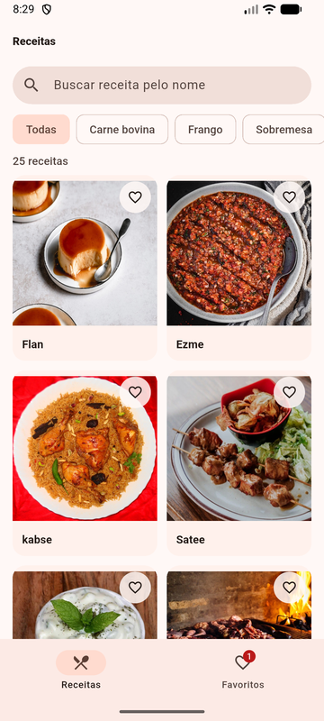
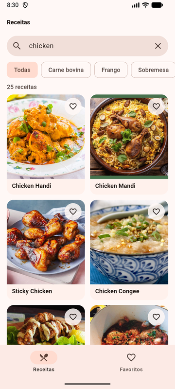
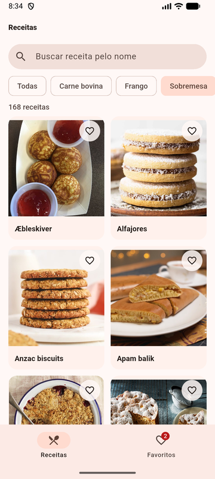
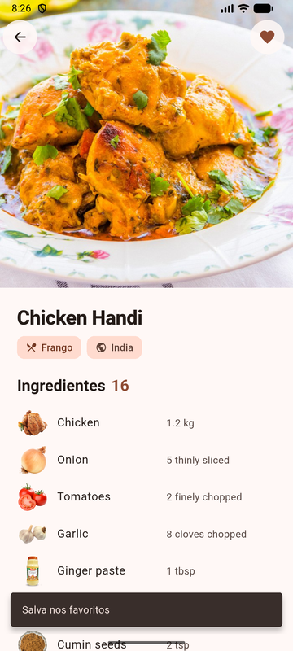
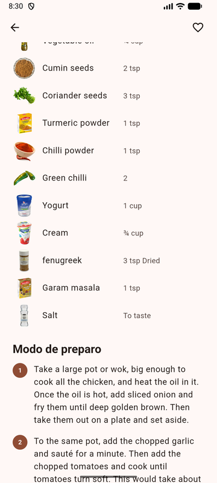
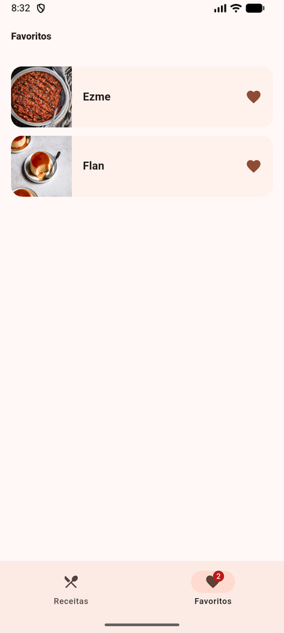
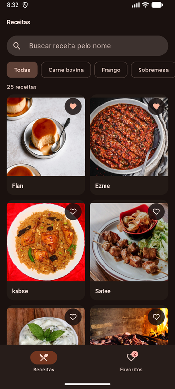
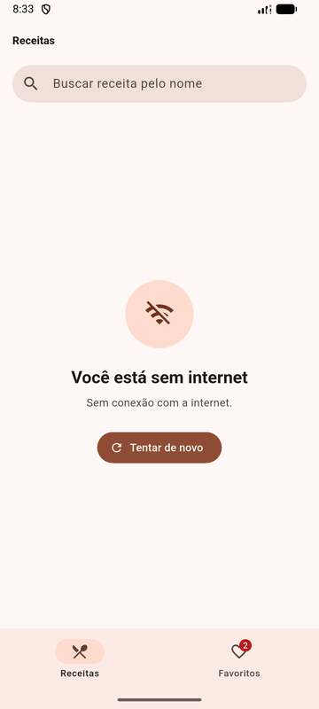
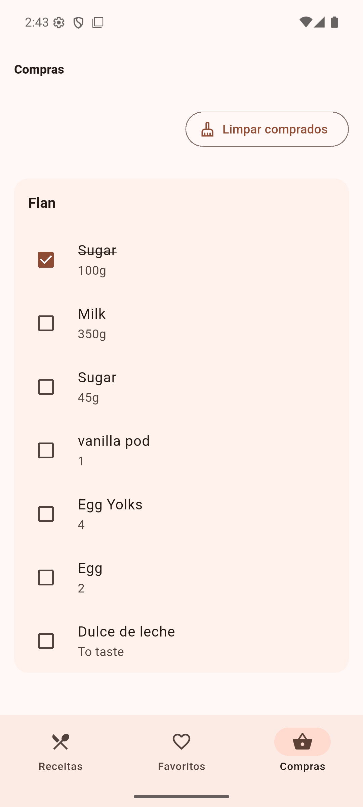

# Receitas — Projeto Final (TheMealDB + Flutter)

App Android em Flutter para descobrir receitas da [TheMealDB](https://www.themealdb.com/api.php):
navegue pela grade de pratos, busque pelo nome, filtre por categoria, abra a receita com ingredientes
e modo de preparo, e guarde suas favoritas (elas continuam salvas depois de fechar o app).

- **Grupo:** Henrique Miguel de Jesus · João Pedro Schlindwein · Rafael Correa Zart
- **Reserva do tema:** [issue #269](https://github.com/jacksonsmith/puc-iec-mobile-multiplataforma/issues/269)
- **Decisões de arquitetura:** [`ADR.md`](./ADR.md)

| Lista | Busca | Categoria | Detalhe |
|---|---|---|---|
|  |  |  |  |

| Modo de preparo | Favoritos | Tema escuro | Sem internet |
|---|---|---|---|
|  |  |  |  |

## O que o app faz

| # | Feature | Como funciona |
|---|---|---|
| 1 | **Lista** de dados reais | Grade de receitas com foto vinda de `search.php?s=`, puxar para atualizar |
| 2 | **Detalhe** | Foto grande, categoria, origem, tags, ingredientes com foto e medida, modo de preparo em passos (`lookup.php?i=`) |
| 3 | **Busca** | Campo de busca que procura no catálogo inteiro da API (`search.php?s=<texto>`), com filtro local instantâneo enquanto a resposta chega |
| 4 | **Filtro por categoria** | Chips com as 14 categorias reais da API (`categories.php`), traduzidas; tocar busca a categoria inteira na API (`filter.php?c=`) |
| 5 | **Favoritos** | Coração na grade e no detalhe; aba Favoritos com contador, arrastar para remover e "Desfazer"; salvos com `shared_preferences` e mantidos ao fechar o app |
| 6 | **Lista de compras** | No detalhe, adicione ou remova os ingredientes da receita; na aba Compras, marque os comprados e use "Limpar comprados". Itens agrupados por receita e salvos ao fechar o app |



**Estados tratados (nunca tela branca):** carregando (skeleton que pulsa), lista vazia ou busca sem
resultado, sem internet e erro do servidor (mensagens diferentes, com botão "Tentar de novo"), foto
que não carrega (ícone no lugar). Os favoritos abrem mesmo sem internet.

**Visual:** Material 3 com tema claro e escuro seguindo o sistema, cores e espaçamentos definidos em
um único arquivo (`lib/ui/theme.dart`), grade que se adapta à largura (2 colunas no celular em pé,
mais em paisagem/tablet).

## Como rodar

Pré-requisitos: **Flutter 3.35+** (testado com 3.47.6, canal stable), **JDK 17** e Android SDK
(emulador ou celular com depuração USB).

```bash
# a partir da raiz do repositório
cd exercicios/projeto-final/skeletons/themealdb/flutter/pratica

flutter pub get
flutter run                 # com emulador aberto ou celular conectado
```

Não precisa de chave: a TheMealDB usa a chave pública de testes `1`, documentada pela própria API.

### Build (critério eliminatório)

```bash
flutter build apk --debug   # gera build/app/outputs/flutter-apk/app-debug.apk
```

> **Se o build reclamar de versão do Java/Gradle:** o projeto usa Gradle 8.14.3, Android Gradle
> Plugin 8.11.1 e Kotlin 2.2.20 (mínimos do Flutter 3.47). Se o Flutter estiver usando um Java mais
> novo que o 17 (ex.: o Java do Android Studio), aponte para o JDK 17:
> `flutter config --jdk-dir "<caminho do JDK 17>"`.
>
> **Windows, "Could not write file" / `ShaderCompilerException`:** é o limite de 260 caracteres de
> caminho do Windows. Clone o repositório numa pasta de caminho curto (ex.: `C:\dev\`).

### Testes

```bash
flutter test     # sem internet (a API é simulada com MockClient)
flutter analyze  # sem avisos
```

| Arquivo | O que testa |
|---|---|
| `test/meal_detail_test.dart` | leitura dos ingredientes (`strIngredient1..20` com vazios, nulos e espaços), tags e passos do preparo |
| `test/meal_list_controller_test.dart` | busca local e na API, categoria + busca combinadas, categoria sem receitas, sem internet × erro HTTP |
| `test/favorites_controller_test.dart` | favorito sobrevive a "fechar o app", remover e desfazer na mesma posição, entrada corrompida ignorada |
| `test/widget_test.dart` | app inteiro: lista → busca → favoritar → aba Favoritos; tela de sem internet |
| `test/shopping_list_controller_test.dart` | ingredientes, marcar/limpar, persistência, duplicatas, registros corrompidos e ordem das gravações |
| `test/shopping_list_screen_test.dart` | detalhe → adicionar/remover compras → aba Compras → marcar e limpar |

Validação da lista de compras em 08/11/2026: `flutter analyze` sem avisos,
23 testes passando e `flutter build apk --debug` concluído (Flutter 3.47.9).
No emulador Clinia Pixel 8: adicionar ingredientes reais de Flan, marcar um item,
encerrar o processo e reabrir preservando o checkbox, e limpar somente os comprados.
O screenshot acima foi capturado após reabrir o app.

## Arquitetura (resumo)

```
lib/
  api/        TheMealDbApi — HTTP + JSON, erros viram ApiException com mensagem para o usuário
  storage/    FavoritesStore, ShoppingListStore — shared_preferences
  models/     MealSummary, MealDetail, Ingredient, ShoppingItem
  state/      MealListController, MealDetailController, FavoritesController, ShoppingListController
  ui/         tema/tokens e widgets reutilizáveis (MealCard, MealImage, StateMessage, Skeleton)
  screens/    ListScreen, DetailScreen, FavoritesScreen, ShoppingListScreen — sem fetch dentro dos widgets
```

Estado com `ChangeNotifier` + `provider`. O porquê, e as alternativas descartadas (Riverpod, Bloc,
`setState` nas telas), está no [`ADR.md`](./ADR.md).

## Testes manuais (Maestro, opcional)

Os flows em `flows/` vieram do skeleton e não são mais avaliados pelo CI. Os identificadores que eles
usam (`item-card-<id>`, `search-input`, `detail-favorite-button`, `tab-favorites`…) foram mantidos,
mas o grupo não rodou o Maestro sobre a interface nova: o visual mudou (grade em vez de lista,
categorias vindas da API), então alguns passos podem precisar de ajuste.
